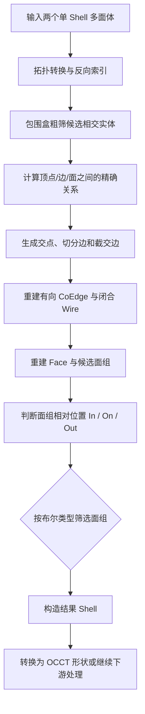

# 多面体布尔算法

本目录实现了一套面向平面多面体 B-Rep 的布尔运算。算法将 OCCT 拓扑转换为内部轻量拓扑模型，在内部完成求交、边界重建和面分类，最后生成结果 Shell，并可转换回 OCCT 形状。

支持的操作类型：

- `UNION`
- `INTERSECT`
- `SUBTRACT`

## 适用范围

当前版本的主路径面向由平面面组成的多面体。推荐输入满足以下条件：

- 输入为合法流形 B-Rep；
- 每个输入实体是一个连通的 `Shell`；
- 面的支撑曲面为平面；
- 边界环方向和拓扑连接关系完整；
- `fuzzyValue` 与模型尺寸相匹配。

非平面曲面求交不属于当前多面体主路径的保证范围。

## 算法流程



流程中各阶段的职责如下：

1. **拓扑转换**：将 `TopoDS_Shell` / `TopoDS_Solid` 转换为内部 `Shell`、`Face`、`Wire`、`CoEdge`、`Edge`、`Vertex`。
2. **候选筛选**：使用包围盒索引减少无关实体之间的精确计算。
3. **几何求交**：处理顶点、边和面之间的相交、重合及贴面关系，并生成切分参数。
4. **边界重建**：由切分边和截交边生成有方向的 CoEdge，追踪闭合 Wire，再构造新的 Face。
5. **面组分类**：根据面组与另一输入 Shell 的相对位置，按 UNION、INTERSECT 或 SUBTRACT 规则保留结果面。
6. **结果输出**：将保留的面组组织为结果 Shell，必要时转换回 OCCT B-Rep。

## 稳定性

在 Release 配置下，使用数百万组多面体样本进行对比验证。样本输入均为单 Shell，当前版本的 custom 布尔算法与 OCCT 布尔算法均成功完成计算。

对每组结果进行几何和计量信息对比，包括面积、体积以及拓扑数量统计。几何量的最大相对差异约为 `1.0e-15`，说明在该类输入上两套实现的几何结果保持一致。

需要注意：几何结果一致不等于拓扑组织完全一致。对于相切、重合面或多个连通结果，custom 与 OCCT 可能采用不同的 Shell/Solid 组织方式，因此应用侧应同时检查：

- `Perform()` 返回值；
- `GetResultShells()` 是否为空；
- 结果形状的合法性；
- 面、边、顶点数量及面积、体积等计量信息。

## 性能对比

在相同 Release 环境、相同输入和相同布尔操作下，对上千组样本进行多次重复测试。计时范围均为核心布尔计算，不包含输入文件读取。

| 指标 | custom 相对 OCCT 的表现 |
|---|---:|
| 中位数提升 | **约 13.38x**，核心布尔耗时减少约 **92.5%** |
| P95 提升 | **约 17.46x**，核心布尔耗时减少约 **94.3%** |

这里的“提升倍数”按 `OCCT 耗时 / custom 耗时` 计算；百分比按 `1 - custom / OCCT` 计算。不同模型的收益会受到面数、相交复杂度、共面关系和容差设置影响。

## 调用示例

下面示例展示读取两个 OCCT 实体、执行 UNION，并将结果转换回 OCCT 形状：

```cpp
#include "Boolean.hxx"
#include "BrepTranslator.hxx"

#include <BRepTools.hxx>
#include <BRep_Builder.hxx>
#include <TopoDS.hxx>
#include <TopoDS_Shape.hxx>
#include <TopoDS_Solid.hxx>

static bool ReadBrep(const char* fileName, TopoDS_Shape& shape)
{
    BRep_Builder builder;
    return BRepTools::Read(shape, fileName, builder) && !shape.IsNull();
}

TopoDS_Shape BooleanUnion(const char* targetFile, const char* toolFile)
{
    TopoDS_Shape targetShape;
    TopoDS_Shape toolShape;
    if (!ReadBrep(targetFile, targetShape) ||
        !ReadBrep(toolFile, toolShape)) {
        return TopoDS_Shape();
    }

    ShellPtr target = BrepTranslator::fromOCC(TopoDS::Solid(targetShape));
    ShellPtr tool = BrepTranslator::fromOCC(TopoDS::Solid(toolShape));
    if (!target || !tool) {
        return TopoDS_Shape();
    }

    Boolean operation(target, tool, BooleanType::UNION, 1.0e-7);
    if (!operation.Perform()) {
        return TopoDS_Shape();
    }

    const std::vector<ShellPtr>& resultShells = operation.GetResultShells();
    if (resultShells.empty()) {
        return TopoDS_Shape();
    }

    std::map<void*, Handle(Standard_Transient)> topoToOcc;
    BRep_Builder builder;
    return BrepTranslator::toOCC(builder, resultShells.front(), topoToOcc);
}
```

如果输入是 `TopoDS_Shell` 或 `TopoDS_Solid`，也可以直接调用对应的 `BrepTranslator::fromOCC()` 重载。对于包含多个独立实体的 Compound，应先拆分并明确每个连通实体的处理策略。

## 使用建议

1. 布尔运算前使用 `BRepCheck_Analyzer` 检查输入合法性。
2. 根据模型尺度选择 `fuzzyValue`，避免使用与单位无关的固定值。
3. 同时检查 `Perform()` 和 `GetResultShells()`。
4. 对结果执行合法性、拓扑数量和面积/体积检查。
5. 对关键业务数据保留操作类型、容差和结果统计，便于定位异常输入。
